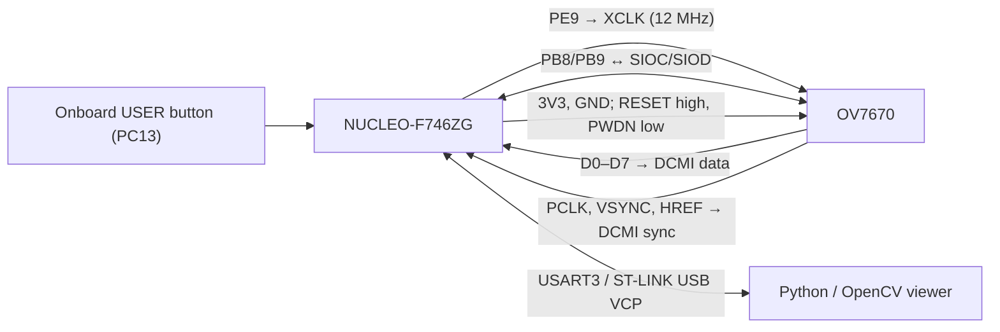

# STM32 OV7670 Camera

A compact embedded computer-vision project using the NUCLEO-F746ZG and a FIFO-less OV7670 camera. The STM32 captures RGB565 frames through DCMI and DMA, converts them to 8-bit grayscale, and streams them to a Python/OpenCV viewer over the ST-LINK virtual COM port. The onboard USER button selects the displayed orientation.

## Features

- 160 × 120 (QQVGA), 8-bit grayscale output
- Hardware DCMI capture with DMA2
- SCCB camera configuration via I2C1
- 12 MHz camera clock generated by TIM1 PWM
- UART request/response protocol, 2,000,000 baud by default
- 90° clockwise rotation per USER button press (performed on the PC)
- Live FPS and rotation indicators
- No external FIFO required

## Repository contents

| File | Purpose |
| --- | --- |
| [main.c](main.c) | STM32 HAL application firmware |
| [camera.py](camera.py) | Desktop image viewer |
| README.md | Wiring and setup guide |

This repository contains the application sources, not a complete standalone CubeIDE project. Generate the supporting HAL, startup, linker, MSP and interrupt files using CubeMX as described below.

## Hardware

- ST NUCLEO-F746ZG (STM32F746ZG, Cortex-M7)
- OV7670 parallel camera module without FIFO
- Jumper wires and a USB data cable for ST-LINK
- Two 4.7 kΩ pull-up resistors for SCCB if the camera module has no suitable pull-ups

## Wiring

All signal names refer to the MCU pins, not the physical connector pin numbers. Use the board's Zio/Morpho pinout to locate each pin. Use 3.3 V logic and a common ground. Confirm your specific camera breakout's supply requirements before applying power.

| OV7670 | NUCLEO-F746ZG | Function |
| --- | --- | --- |
| VCC | 3V3 | Supply (3.3 V-compatible breakout) |
| GND | GND | Common ground |
| SIOC / SCL | PB8 | I2C1_SCL |
| SIOD / SDA | PB9 | I2C1_SDA |
| XCLK | PE9 | TIM1_CH1 |
| PCLK | PA6 | DCMI_PIXCLK |
| VSYNC | PG9 | DCMI_VSYNC |
| HREF | PA4 | DCMI_HSYNC |
| D0 | PC6 | DCMI_D0 |
| D1 | PC7 | DCMI_D1 |
| D2 | PC8 | DCMI_D2 |
| D3 | PC9 | DCMI_D3 |
| D4 | PE4 | DCMI_D4 |
| D5 | PD3 | DCMI_D5 |
| D6 | PE5 | DCMI_D6 |
| D7 | PE6 | DCMI_D7 |
| RESET | 3V3 | Camera reset inactive |
| PWDN | GND | Camera power-down inactive |

Some breakouts label D0–D7 as Y2–Y9 respectively. Do not confuse XCLK (input to the camera) with PCLK (output from the camera). If necessary, connect a 4.7 kΩ resistor from each of SIOC and SIOD to 3V3.

### Connection diagram



## STM32CubeMX setup

Create a board project for NUCLEO-F746ZG (STM32F746ZGTx). The application was developed with STM32CubeIDE 2.x and STM32CubeF7 HAL. Configure the following peripherals before generating code.

| Peripheral | Configuration |
| --- | --- |
| SYSCLK | HSI PLL: M=8, N=72, P=2, Q=3; SYSCLK/HCLK 72 MHz |
| Bus clocks | APB1 /2 (36 MHz), APB2 /1 (72 MHz) |
| I2C1 | PB8/PB9, standard mode 100 kHz; timing 0x00808CD2 |
| TIM1 | PWM channel 1 on PE9; prescaler 0, ARR 5, pulse 3; 12 MHz, 50% duty |
| DCMI | Hardware synchronization, 8-bit, rising PCLK, VSYNC high, HSYNC low; all frames, bytes and lines; JPEG disabled |
| DCMI DMA | DMA2 Stream 1, peripheral-to-memory, normal mode, peripheral/memory word alignment, memory increment on, peripheral increment off, very high priority, FIFO disabled |
| NVIC | Enable DCMI and DMA2 Stream 1 interrupts |
| USART3 | PD8 TX, PD9 RX, 8N1, no flow control, 2,000,000 baud |
| USER button | PC13, GPIO input, no internal pull |
| LEDs | PB0 and PB14, GPIO output |

Use the exact DCMI alternate-function mapping in the wiring table. Set the DMA request/channel for DCMI using CubeMX. Keep the D-cache disabled in this simple example and place the DMA capture buffer in DMA-accessible SRAM (not DTCM).

The firmware declares ETH and USB PCD handles for compatibility with the original board-generated project. If your generated project has those peripherals disabled, either enable their HAL modules or remove the unused declarations and any corresponding unused MSP/interrupt references.

1. Generate the STM32CubeIDE project.
2. Replace **Core/Src/main.c only** with this repository's main.c.
3. Keep the generated startup, system, linker, HAL and MSP files. The generated MSP code must configure the GPIO alternate functions and initialize/link hdma_dcmi to hdcmi.
4. Ensure the generated interrupt handlers include the following calls:

```c
void DMA2_Stream1_IRQHandler(void)
{
    HAL_DMA_IRQHandler(&hdma_dcmi);
}

void DCMI_IRQHandler(void)
{
    HAL_DCMI_IRQHandler(&hdcmi);
}
```

SysTick_Handler must call HAL_IncTick() for the default HAL time base. Keep the generated interrupt declarations and other required handlers.

5. Build, flash through ST-LINK, and reset the board without holding the USER button. Do not overwrite startup or interrupt files with main.c.

## PC installation

Install Python 3 and the required packages:

```bash
python -m pip install pyserial opencv-python numpy
```

Find the ST-LINK Virtual COM Port in Windows Device Manager. Close PuTTY or any other application using the port before launching the viewer.

```bash
python camera.py --port COM19 --baud 2000000
```

Replace COM19 with your actual port. If the serial connection is unreliable, reduce BAUD_RATE in main.c to 921600 or 115200, rebuild and flash, then pass the same value to camera.py using --baud. Lower baud rates reduce frame rate.

Press the blue USER button to rotate the image 90° clockwise on each press. PB14 (red LD3) toggles when the firmware detects a press. Press Esc in the viewer to exit.

## Serial protocol

Each frame is requested by sending ASCII c.

| Field | Size |
| --- | ---: |
| ASCII header GRY2 | 4 bytes |
| Rotation index (0–3) | 1 byte |
| Grayscale pixels, row-major | 19,200 bytes |
| Total | 19,205 bytes |

The camera is captured as RGB565 (38,400 bytes) and converted in-place to grayscale using integer luminance weights. Rotation is performed by the Python viewer. A capture failure returns an ASCII error starting with ERR!.

At 2 Mbaud with 8N1, the UART-only theoretical ceiling is approximately 10.4 FPS. Actual performance is lower due to capture, processing, USB/serial transport and rendering overhead. This is not a measured benchmark.

## Troubleshooting

Open a serial terminal at the same baud rate and reset the board. Expected startup messages:

```text
STM32 OK
XCLK OK
CAMERA CONFIGURED
DCMI OK
CAMERA BUTTON READY
```

- **No response:** Check COM port, baud rate, cable, firmware and debugger call stack.
- **HardFault during SCB_DisableDCache():** The firmware checks whether D-cache is enabled before attempting to disable it. This change restored startup messages in the original setup.
- **CAMERA WRITE ERROR:** Check XCLK, SCCB wiring, pull-ups, camera supply and reset/power-down pins.
- **ERR!DMA:** Check DCMI pin mapping, signal polarity, DMA request/interrupts and memory placement.
- **Incomplete image:** Verify matching firmware/viewer protocol and baud rate; try a lower baud rate.
- **Button does not rotate:** Check whether LD3 toggles; if it does, inspect the viewer's rotation byte handling.

## Project status

The original hardware setup produced grayscale frames, and the guarded D-cache change restored firmware startup. The repository revision has not yet been independently built or tested end-to-end on hardware; the button behavior and sustained FPS should be verified. No trained TinyML model is included.

## References

- [ST NUCLEO-F746ZG](https://www.st.com/en/evaluation-tools/nucleo-f746zg.html)
- [STM32CubeF7](https://github.com/STMicroelectronics/STM32CubeF7)
- [OpenCV](https://opencv.org/)
- [pySerial](https://pyserial.readthedocs.io/)

