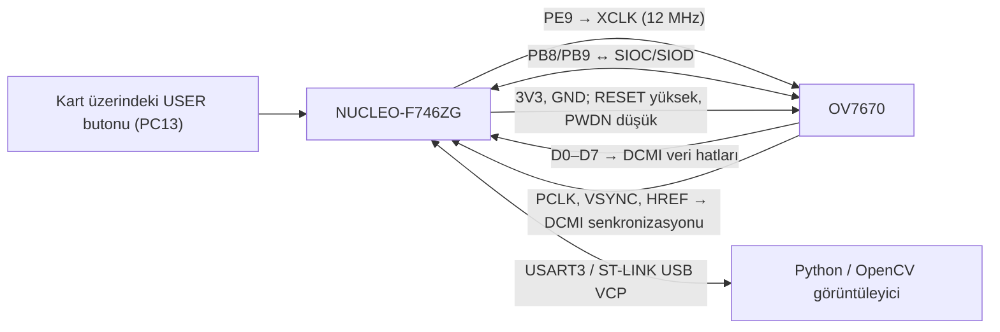

# STM32 OV7670 Kamera

[English documentation](README.md)

NUCLEO-F746ZG geliştirme kartı ve FIFO'suz OV7670 kamera modülü kullanılarak geliştirilen gömülü görüntü işleme projesidir. STM32, DCMI ve DMA aracılığıyla RGB565 formatında görüntü yakalar, görüntüyü 8 bit gri tonlamaya dönüştürür ve ST-LINK sanal COM portu üzerinden Python/OpenCV uygulamasına aktarır. Kart üzerindeki USER butonu görüntünün yönünü değiştirmek için kullanılır.

## Özellikler

- 160 × 120 (QQVGA) çözünürlük, 8 bit gri tonlamalı görüntü
- DCMI ve DMA2 ile donanımsal görüntü yakalama
- I2C1 üzerinden SCCB kamera yapılandırması
- TIM1 PWM ile 12 MHz kamera saat sinyali
- Varsayılan 2.000.000 baud UART istek/yanıt protokolü
- USER butonuna her basıldığında saat yönünde 90° görüntü döndürme (bilgisayar tarafında)
- Canlı FPS ve dönüş açısı göstergesi
- Harici FIFO gerektirmez

## Depo içeriği

| Dosya | Açıklama |
| --- | --- |
| [main.c](main.c) | STM32 HAL uygulama yazılımı |
| [camera.py](camera.py) | Bilgisayarda canlı görüntü izleme uygulaması |
| [README.md](README.md) | İngilizce bağlantı ve kurulum rehberi |
| README_TR.md | Türkçe bağlantı ve kurulum rehberi |

Bu depo uygulama kaynak kodlarını içerir; tek başına derlenebilen eksiksiz bir CubeIDE projesi değildir. Gerekli HAL, startup, linker, MSP ve kesme dosyalarını aşağıdaki ayarlarla STM32CubeMX üzerinden oluşturun.

## Gerekli donanımlar

- ST NUCLEO-F746ZG (STM32F746ZG, Cortex-M7)
- FIFO'suz OV7670 paralel kamera modülü
- Jumper kablolar ve ST-LINK için USB veri kablosu
- Kamera modülünde uygun pull-up dirençleri yoksa iki adet 4,7 kΩ direnç

## Devre bağlantıları

Tabloda fiziksel konnektör numaraları değil, mikrodenetleyicinin pin isimleri verilmiştir. Pinlerin konumunu kartın Zio/Morpho pin şemasından bulun. 3,3 V lojik seviyesi ve ortak GND kullanın. Enerji vermeden önce kamera modülünüzün besleme gerilimi gereksinimlerini kontrol edin.

| OV7670 | NUCLEO-F746ZG | İşlev |
| --- | --- | --- |
| VCC | 3V3 | Besleme (3,3 V uyumlu modül) |
| GND | GND | Ortak toprak |
| SIOC / SCL | PB8 | I2C1_SCL |
| SIOD / SDA | PB9 | I2C1_SDA |
| XCLK | PE9 | TIM1_CH1 |
| PCLK | PA6 | DCMI_PIXCLK |
| VSYNC | PG9 | DCMI_VSYNC |
| HREF | PA4 | DCMI_HSYNC |
| D0 | PC6 | DCMI_D0 |
| D1 | PC7 | DCMI_D1 |
| D2 | PC8 | DCMI_D2 |
| D3 | PC9 | DCMI_D3 |
| D4 | PE4 | DCMI_D4 |
| D5 | PD3 | DCMI_D5 |
| D6 | PE5 | DCMI_D6 |
| D7 | PE6 | DCMI_D7 |
| RESET | 3V3 | Kamera reseti pasif |
| PWDN | GND | Kamera güç tasarrufu modu pasif |

Bazı modüllerde D0–D7 pinleri sırasıyla Y2–Y9 olarak etiketlenir. XCLK (kamera girişi) ile PCLK (kamera çıkışı) sinyallerini karıştırmayın. Gerekiyorsa SIOC ve SIOD hatlarının her birini 4,7 kΩ direnç üzerinden 3V3'e bağlayın.

### Bağlantı şeması



## STM32CubeMX yapılandırması

NUCLEO-F746ZG (STM32F746ZGTx) için yeni bir kart projesi oluşturun. Uygulama STM32CubeIDE 2.x ve STM32CubeF7 HAL ile geliştirilmiştir. Kod üretmeden önce aşağıdaki çevre birimlerini yapılandırın.

| Çevre birimi | Ayarlar |
| --- | --- |
| SYSCLK | HSI PLL: M=8, N=72, P=2, Q=3; SYSCLK/HCLK 72 MHz |
| Veri yolu saatleri | APB1 /2 (36 MHz), APB2 /1 (72 MHz) |
| I2C1 | PB8/PB9, Standard Mode 100 kHz; timing 0x00808CD2 |
| TIM1 | PE9 üzerinde PWM Channel 1; prescaler 0, ARR 5, pulse 3; 12 MHz, %50 görev döngüsü |
| DCMI | Hardware synchronization, 8 bit, PCLK rising, VSYNC high, HSYNC low; tüm kareler, baytlar ve satırlar; JPEG kapalı |
| DCMI DMA | DMA2 Stream 1, Peripheral to Memory, Normal, çevre birimi/bellek veri genişliği Word, Memory Increment açık, Peripheral Increment kapalı, Very High priority, FIFO kapalı |
| NVIC | DCMI ve DMA2 Stream 1 kesmeleri açık |
| USART3 | PD8 TX, PD9 RX, 8N1, akış kontrolü yok, 2.000.000 baud |
| USER butonu | PC13, GPIO Input, dahili pull-up/pull-down yok |
| LED'ler | PB0 ve PB14, GPIO Output |

Bağlantı tablosundaki DCMI alternatif pin işlevlerini kullanın. DCMI için DMA request/channel ayarını CubeMX üzerinden yapın. Bu örnekte D-Cache kapalı tutulmalı ve DMA görüntü tamponu DMA'nın erişebildiği SRAM bölgesinde bulunmalıdır (DTCM'de değil).

Firmware, orijinal kart projesiyle uyumluluk için ETH ve USB PCD handle tanımları içerir. Oluşturduğunuz projede bu çevre birimleri kapalıysa ilgili HAL modüllerini etkinleştirin veya kullanılmayan tanımları ve bunlara ait kullanılmayan MSP/kesme referanslarını kaldırın.

1. STM32CubeIDE projesini oluşturun.
2. Yalnızca **Core/Src/main.c** dosyasını depodaki main.c ile değiştirin.
3. Oluşturulan startup, system, linker, HAL ve MSP dosyalarını koruyun. MSP kodunun GPIO alternatif işlevlerini yapılandırması, hdma_dcmi'yi başlatması ve hdcmi ile ilişkilendirmesi gerekir.
4. Oluşturulan kesme fonksiyonlarının aşağıdaki çağrıları içerdiğini kontrol edin:

```c
void DMA2_Stream1_IRQHandler(void)
{
    HAL_DMA_IRQHandler(&hdma_dcmi);
}

void DCMI_IRQHandler(void)
{
    HAL_DCMI_IRQHandler(&hdcmi);
}
```

Varsayılan HAL zaman tabanı için SysTick_Handler içerisinde HAL_IncTick() çağrılmalıdır. Oluşturulan kesme tanımlarını ve diğer gerekli kesme fonksiyonlarını koruyun.

5. Projeyi derleyin, ST-LINK üzerinden karta yükleyin ve USER butonuna basmadan kartı resetleyin. Startup veya kesme dosyalarının üzerine main.c kodunu yapıştırmayın.

## Python kurulumu ve çalıştırma

Python 3'ü ve gerekli kütüphaneleri kurun:

```bash
python -m pip install pyserial opencv-python numpy
```

Windows Aygıt Yöneticisi üzerinden ST-LINK Virtual COM Port numarasını öğrenin. Görüntüleyiciyi başlatmadan önce PuTTY'yi ve seri portu kullanan diğer uygulamaları kapatın.

```bash
python camera.py --port COM19 --baud 2000000
```

COM19 yerine kendi seri portunuzu yazın. Haberleşme kararsızsa main.c dosyasındaki BAUD_RATE değerini 921600 veya 115200 olarak değiştirin, yeniden derleyip karta yükleyin. Python uygulamasını da --baud parametresiyle aynı hızda çalıştırın. Daha düşük baud rate, görüntü aktarım hızını azaltır.

Mavi USER butonuna her basıldığında görüntü saat yönünde 90° döner. Firmware buton basışını algıladığında PB14 üzerindeki kırmızı LD3 LED'i durum değiştirir. Görüntüleyiciden çıkmak için Esc tuşuna basın.

## Seri haberleşme protokolü

Her görüntü karesi bilgisayardan ASCII c karakteri gönderilerek istenir.

| Alan | Boyut |
| --- | ---: |
| ASCII GRY2 başlığı | 4 bayt |
| Dönüş indeksi (0–3) | 1 bayt |
| Satır sırasıyla gri tonlamalı piksel verileri | 19.200 bayt |
| Toplam | 19.205 bayt |

Görüntü RGB565 biçiminde (38.400 bayt) yakalanır ve tamsayı parlaklık katsayılarıyla aynı tampon üzerinde gri tonlamaya dönüştürülür. Görüntü döndürme işlemini Python uygulaması gerçekleştirir. Görüntü yakalama hatalarında ERR! ile başlayan ASCII hata mesajı gönderilir.

2 Mbaud ve 8N1 ayarlarıyla yalnızca UART aktarımı açısından teorik üst sınır yaklaşık 10,4 FPS'dir. Görüntü yakalama, işleme, USB/seri aktarım ve ekrana çizim süreleri nedeniyle gerçek FPS daha düşüktür. Bu değer ölçülmüş performans sonucu değildir.

## Hata giderme

Aynı baud rate ile seri terminali açın ve kartı resetleyin. Beklenen başlangıç mesajları:

```text
STM32 OK
XCLK OK
CAMERA CONFIGURED
DCMI OK
CAMERA BUTTON READY
```

- **Yanıt yok:** COM portunu, baud rate'i, USB kablosunu, firmware'i ve debugger çağrı yığınını kontrol edin.
- **SCB_DisableDCache() sırasında HardFault:** Firmware, D-Cache'i kapatmadan önce etkin olup olmadığını kontrol eder. Bu değişiklik orijinal sistemde başlangıç mesajlarının tekrar alınmasını sağlamıştır.
- **CAMERA WRITE ERROR:** XCLK, SCCB bağlantıları, pull-up dirençleri, kamera beslemesi, RESET ve PWDN pinlerini kontrol edin.
- **ERR!DMA:** DCMI pin eşleşmesini, sinyal polaritesini, DMA request ve kesme ayarlarını, tamponun bellek konumunu kontrol edin.
- **Eksik görüntü:** Firmware ve Python protokolünün, baud rate değerlerinin eşleştiğinden emin olun. Gerekirse daha düşük baud rate deneyin.
- **Buton görüntüyü döndürmüyor:** LD3 LED'inin durum değiştirip değiştirmediğini kontrol edin. LED değişiyorsa Python uygulamasının dönüş baytını nasıl işlediğini inceleyin.

## Projenin durumu

Orijinal donanım kurulumunda gri tonlamalı görüntü elde edilmiştir. D-Cache kontrolü eklendikten sonra firmware'in başlangıç aşaması yeniden çalışmıştır. Depodaki son sürüm henüz bağımsız olarak derlenmemiş ve fiziksel donanım üzerinde uçtan uca test edilmemiştir. Buton işlevi ve sürekli görüntü aktarımındaki FPS doğrulanmalıdır. Proje eğitilmiş bir TinyML modeli içermez.

## Kaynaklar

- [ST NUCLEO-F746ZG](https://www.st.com/en/evaluation-tools/nucleo-f746zg.html)
- [STM32CubeF7](https://github.com/STMicroelectronics/STM32CubeF7)
- [OpenCV](https://opencv.org/)
- [pySerial](https://pyserial.readthedocs.io/)
